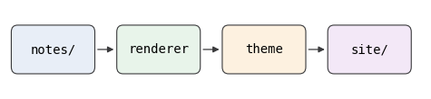

= Lighthouse CLI: User Guide
Helena Marsh <h.marsh@northfield.example>
v2.3.0, 2026-02-14: Spring release
:toc: left
:toclevels: 2
:icons: font
:source-highlighter: rouge
:product: Lighthouse
:experimental:

{product} is a small command-line tool that watches a folder of Markdown notes
and publishes them as a static site. This guide covers installation, daily use
and configuration.

== Installation

{product} needs Ruby 3.2 or later. Install it from RubyGems:

[source,shell]
----
gem install lighthouse-cli
lighthouse --version
----

TIP: On macOS, use the Ruby from Homebrew rather than the system Ruby, which is
read-only.

=== Checking the install

Run `lighthouse doctor`. It prints *green* checks for everything it finds and
_explains_ anything missing. Output that needs attention is #highlighted#.

....
$ lighthouse doctor
✓ ruby 3.3.1
✓ git 2.44.0
✗ pandoc not found (optional, for PDF export)
....

== Daily use

. Write notes in `notes/` as Markdown files.
. Run `lighthouse serve` and open the local address it prints.
. Press kbd:[Ctrl+C] to stop, then `lighthouse publish` when you are happy.
.. Publishing builds into `site/`.
.. It then pushes to the branch named in the configuration.

NOTE: `lighthouse serve` rebuilds only the pages that changed, so large sites
stay fast. See <<configuration>> for the options that control this.

WARNING: `lighthouse publish --force` overwrites the remote branch. Your
previous site history is lost.

=== What gets published

* Every Markdown file under `notes/`
** except files whose name starts with an underscore
** and drafts marked `draft: true`
* Images referenced by those files
* The theme's assets

=== Checklist before a release

* [x] Spell-check new notes
* [x] Run `lighthouse check --links`
* [ ] Update the changelog

[[configuration]]
== Configuration

Settings live in `lighthouse.yml` at the root of the project.

.Example configuration
[source,ruby]
----
# lighthouse.rb: optional Ruby hooks run after each build
Lighthouse.after_build do |site|
  site.pages.each do |page|
    page.meta["reading_time"] = (page.words / 230.0).ceil
  end
end
----

[cols="1,2,1",options="header"]
|===
|Option |Description |Default

|`source`
|Folder containing your notes
|`notes`

|`output`
|Folder the site is built into
|`site`

|`branch`
|Git branch that `publish` pushes to
|`gh-pages`

|`incremental`
|Rebuild only changed pages while serving
|`true`
|===

Terms used above::
source::: The input folder. Relative to the project root.
output::: The build folder. Deleted and recreated on every full build.

[IMPORTANT]
====
{product} never deletes files outside `output`. If a build fails half way,
the previous site is left untouched.
====

== Themes

Themes are folders of templates and assets. Start from the default one and
change what you need.footnote:[The default theme is MIT-licensed, so you can
ship your changes without asking.]

[quote, Robert Bringhurst, The Elements of Typographic Style]
____
Typography exists to honor content.
____

.Sidebar: why not a database?
****
Plain files are easy to back up, diff and edit with any tool. {product} keeps
everything in the folder you can see.
****

== Getting help

Read the full reference at https://example.org/lighthouse/docs[the documentation site]
or open an issue on link:https://example.org/lighthouse/issues[the tracker].

// Comment: keep this guide under five pages.
