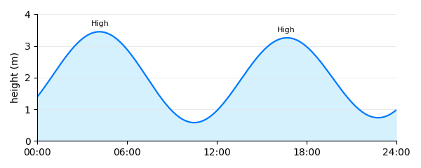

===========
tidewatch
===========

------------------------------------------
Tide predictions for harbours, from Python
------------------------------------------

:Author: Tomás Okafor
:Version: 1.4.0
:License: MIT
:Date: 2026-02-20

.. contents:: Table of contents
   :depth: 2

.. This is a comment. It does not appear in the rendered document.

Overview
========

*tidewatch* predicts water levels from harmonic constituents published by
national hydrographic offices. It is **fast**, has no dependencies beyond
NumPy, and works offline. Install it with ``pip install tidewatch`` or read
the `full documentation <https://example.org/tidewatch>`_.

Features
--------

- Predictions for any time span, at any interval
- High and low waters with their times and heights
- Over 3,000 harbours bundled, including every port in the
  Northern Archipelago

  - Data is updated twice a year
  - Custom harbours can be added from a CSV file

Quick start
-----------

#. Install the package.
#. Choose a harbour by name or station number.
#. Ask for a range of times.

.. code-block:: python

   from datetime import datetime, timedelta
   import tidewatch

   harbour = tidewatch.harbour("Skerry Point")
   start = datetime(2026, 3, 1)
   for event in harbour.extremes(start, start + timedelta(days=1)):
       print(f"{event.kind:5} {event.time:%H:%M} {event.height:.2f} m")

The output looks like this::

   High  04:12 3.41 m
   Low   10:31 0.62 m
   High  16:40 3.28 m
   Low   22:55 0.71 m

.. note::
   Heights are relative to chart datum, not mean sea level. Add the
   harbour's ``datum_offset`` to convert.

.. warning::
   Predictions do not include storm surge. Never use them alone for
   navigation.

How it works
============

The water level at time :math:`t` is a sum of cosines, one per constituent:

.. math::

   h(t) = Z_0 + \sum_{i=1}^{N} f_i H_i \cos\left(\omega_i t + (V_0 + u)_i - g_i\right)

where :math:`H_i` and :math:`g_i` are the amplitude and phase of
constituent :math:`i`. The principal lunar constituent M2 usually
dominates [#m2]_.

Constituents
~~~~~~~~~~~~

=========  ==================  ==============
Name       Period (hours)      Origin
=========  ==================  ==============
M2         12.42               Principal lunar
S2         12.00               Principal solar
K1         23.93               Lunisolar diurnal
O1         25.82               Principal lunar diurnal
=========  ==================  ==============

Accuracy
~~~~~~~~

+----------------+-------------------+------------------+
| Harbour type   | Typical error     | Worst observed   |
+================+===================+==================+
| Open coast     | ±5 cm             | ±18 cm           |
+----------------+-------------------+------------------+
| Estuary        | ±12 cm, ±10 min   | ±40 cm           |
+----------------+-------------------+------------------+

Glossary
========

chart datum
   The level below which the water rarely falls; depths on charts are
   measured from it.

spring tide
   A tide with an unusually large range, near new and full moon.

.. tip::
   Run ``tidewatch harbours --near 59.9,10.7`` to find stations by position.

.. toctree::
   :maxdepth: 2

   api
   changelog

.. [#m2] M2 has a period of 12.42 hours, half a lunar day.
