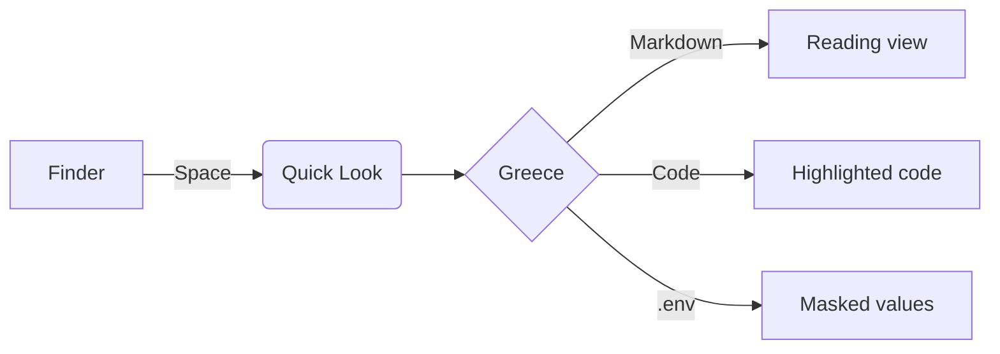

# Markdown Extras

Everything here renders in Quick Look with no network: ==highlighted text==, H~2~O, E = mc^2^, and
abbreviations like HTML and CSS. See [[Getting Started]], [[Getting Started#Install|the install notes]],
or jump to [[#Definition lists]]. A footnote sits here[^speed] and another one here[^offline].

*[HTML]: HyperText Markup Language
*[CSS]: Cascading Style Sheets

## Install

=== "macOS"

    Install with Homebrew, then open Greece once so macOS registers it.

    ```sh
    brew install --cask greece
    open -a Greece
    ```

=== "From Source"

    ```sh
    git clone https://example.com/greece.git
    xcodebuild -scheme Greece
    ```

=== "Mac App Store"

    Search for **Greece** and install it.

## Callouts

> [!note]
> GitHub-style alerts keep working.

> [!tip] Faster previews
> Press **Space** in Finder, then use the arrow keys.

> [!warning]- Folded until you open it
> Obsidian-style callouts with `-` start folded; `+` starts open.

> [!success]+ Everything passed
> 214 tests, 0 failures.

> [!bug] Known issue
> Very wide tables scroll sideways rather than wrap.

!!! example "MkDocs admonition"
    Admonitions from Material for MkDocs render the same way.

:::danger[Docusaurus container]
Containers from Docusaurus and VitePress are callouts too.
:::

## Package managers

:::tabs
== npm
```sh
npm install greece-cli
```
== pnpm
```sh
pnpm add greece-cli
```
== Yarn
```sh
yarn add greece-cli
```
:::

## Definition lists

Quick Look
: The macOS feature that previews a file when you press Space.

Thumbnail
: A small picture of a file's contents, drawn in Finder.
: Greece draws them natively, without a web view.

## Tasks

- [x] Tabs
- [x] Callouts
- [x] Wiki links
- [x] Definition lists
- [ ] Tour video
- [ ] Release notes
- [x] Footnote popovers

## Diagram



## Images


[^speed]: Previews paint in under a few hundred milliseconds, even for long documents.
[^offline]: Nothing is fetched from the network unless you allow remote images in Settings.
