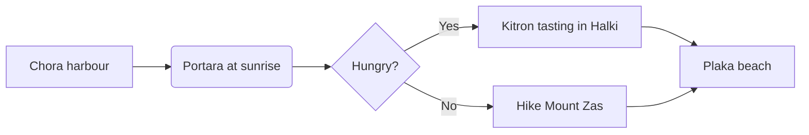

# A Field Guide to the Cyclades

The Cyclades are a ring of 220 islands in the southern Aegean, named for the *kyklos* — the circle — they draw around the sacred island of **Delos**. This guide shows what Greece can do with an ordinary Markdown file.

> [!TIP]
> Press <kbd>Space</kbd> on any Markdown file in Finder. Greece renders it instantly, with no internet connection and nothing leaving your Mac.

## Getting there

Ferries leave Piraeus and Rafina every morning. The fast boats are quicker; the slow ones have better decks.

| Island     | From Piraeus | Fast ferry | Conventional |
|:-----------|-------------:|-----------:|-------------:|
| Syros      |       144 km |     2 h 15 |       3 h 45 |
| Paros      |       168 km |     2 h 50 |       4 h 30 |
| Naxos      |       190 km |     3 h 20 |       5 h 30 |
| Santorini  |       287 km |     4 h 50 |       8 h 00 |

## Packing list

- [x] Linen shirts and a wide hat
- [x] Reef-safe sunscreen
- [ ] A paperback for the slow boat
- [ ] Euros in small notes for the kafeneio

## Reading the wind

The *meltemi* blows from the north in July and August. Sailors estimate its force from wave height with a rough rule:

$$
F \approx \left(\frac{H}{0.0248}\right)^{2/3}
$$

where $H$ is the significant wave height in metres and $F$ is the Beaufort force.

> [!WARNING]
> When the meltemi reaches force 7, small ferries stay in port. Keep a spare day at the end of any trip.

## A day on Naxos



## Planning a route

Greece highlights more than 190 languages, in code blocks too:

```swift
struct Ferry: Identifiable {
    let id = UUID()
    var name: String
    var departure: Date
    var islands: [String]

    var isOvernight: Bool {
        Calendar.current.component(.hour, from: departure) >= 21
    }
}
```

```python
def best_route(islands, start="Piraeus"):
    """Visit every island once, always sailing to the nearest next."""
    route, here = [start], start
    while remaining := [i for i in islands if i not in route]:
        here = min(remaining, key=lambda i: distance(here, i))
        route.append(here)
    return route
```

Inline code like `ferry.isOvernight` and <mark>highlights</mark> read naturally, and footnotes work too.[^1]

<details>
<summary>What does “Cyclades” mean?</summary>

From the Greek *kyklos*, circle: the islands ring the sanctuary of Delos.
</details>

---

Made with Greece. Emoji shortcodes work too :sailboat: :sunny:

[^1]: Delos was a sacred sanctuary. By ancient law, nobody could be born or buried on the island.
