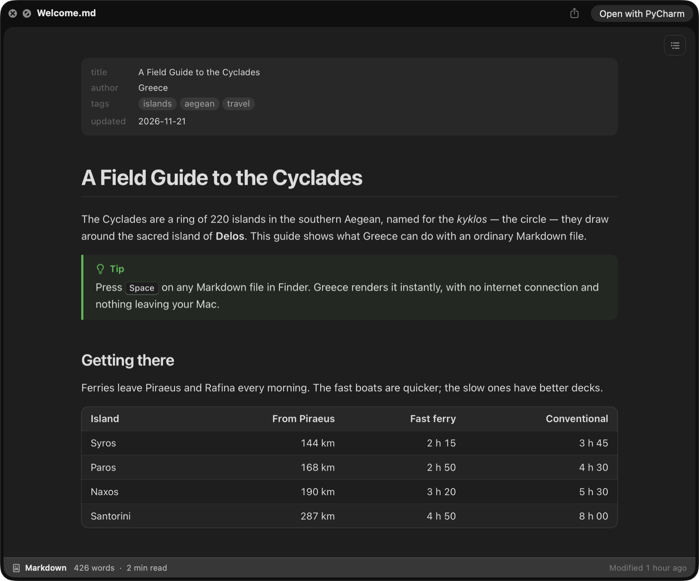
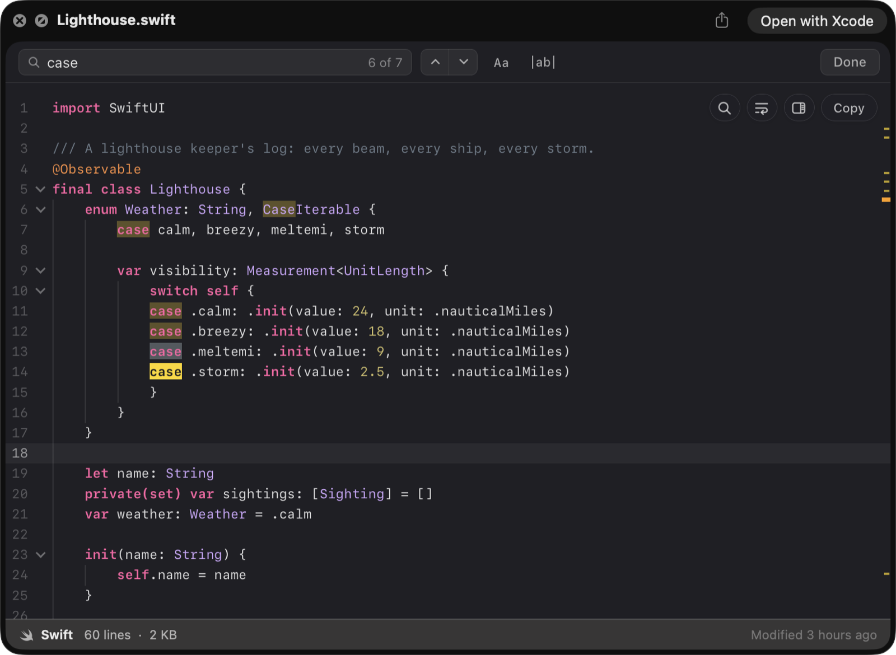
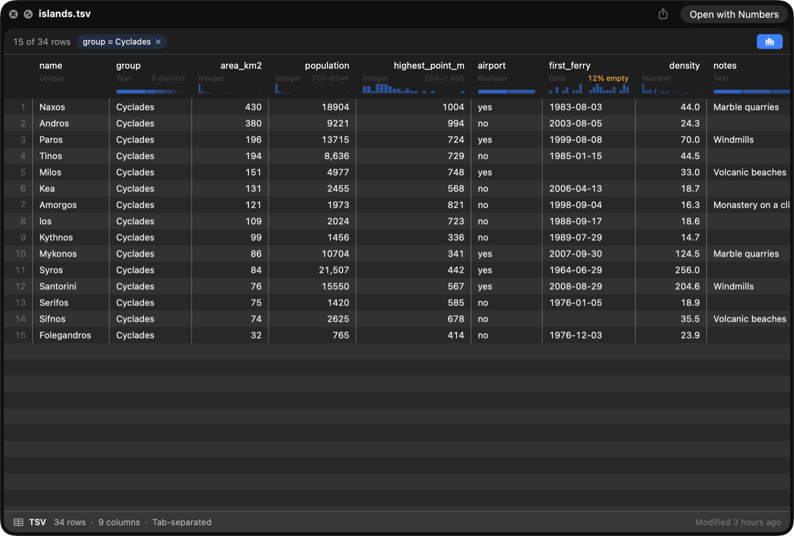
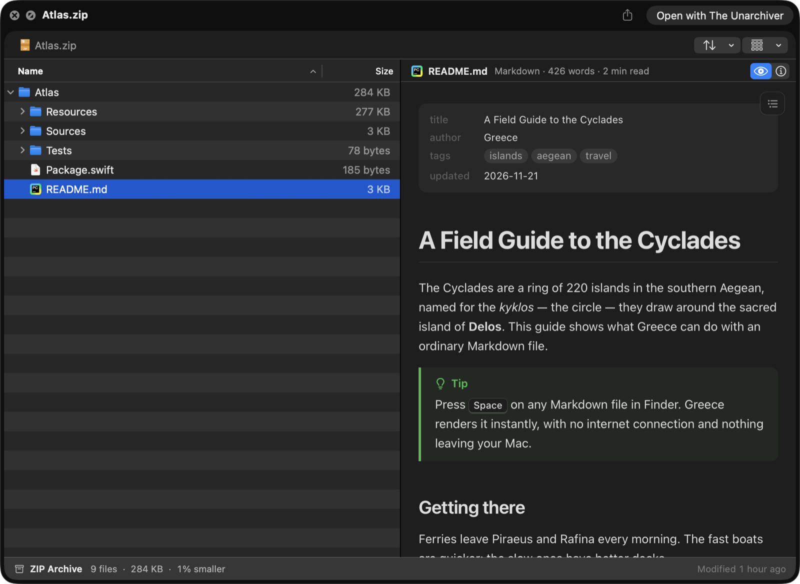
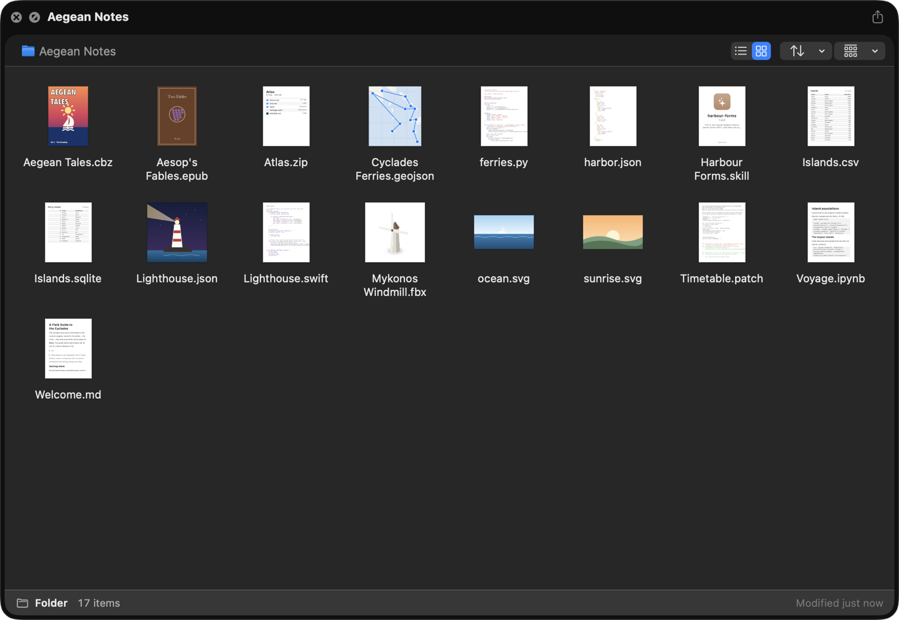
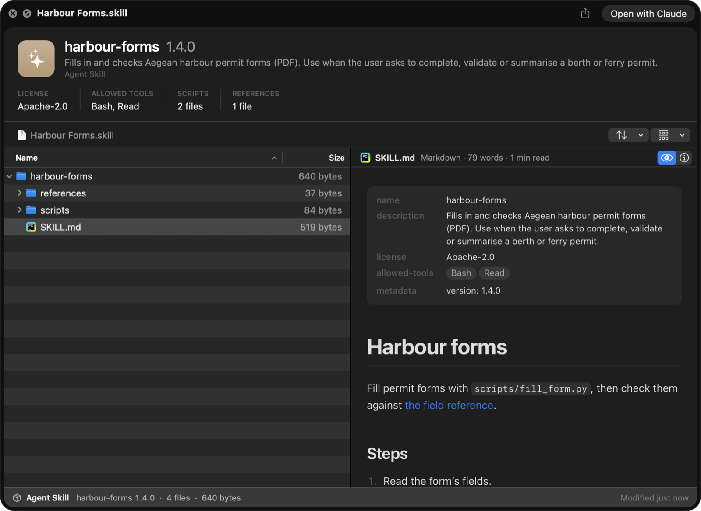

# Greece

**Press Space. See everything.**

Greece makes Quick Look beautiful and useful for the files developers, writers and designers live in. Select a file in Finder, press <kbd>Space</kbd>, and you get typeset Markdown, highlighted code you can search, real tables you can filter, archives, disk images and folders you can browse file by file, maps, 3D models, fonts, apps and more. Everything happens on your Mac, in a fraction of a second.

<p align="center">
  
  
</p>
<p align="center">
  
  
</p>
<p align="center">
  
  
</p>

## What Greece previews

Greece ships eight Quick Look extensions, one per family of formats, so you can switch any family off in System Settings and hand it back to macOS. Together they take 307 file types.

| Family | Formats | What you get |
|---|---|---|
| **Code & Text** | 257 languages and config formats, JSON, plists, diffs, logs, `.env`, Dockerfiles, Makefiles | Xcode-quality highlighting in 49 themes, folding, sticky headers, bracket matching, indent guides, a symbols sidebar, find, wrap, and a JSON tree. Minified JSON, CSS, SQL, XML and JavaScript are formatted. Smart cards sit above the code: see below. |
| **Markdown & Documents** | Markdown, MDX, R Markdown, Quarto, Livebook, Jupyter notebooks, LaTeX, BibTeX, Typst, AsciiDoc, reStructuredText, Org, EPUB, Mermaid | GitHub Flavored Markdown with alerts and callouts in every dialect, tabs, wiki links, footnote popovers, KaTeX math, Mermaid diagrams you can zoom, an outline, find, and a reading theme of your choice. LaTeX is typeset; books open on their cover and contents. |
| **Data & Tables** | TSV and other delimited tables, JSON Lines, Parquet, SQLite, dBase, HAR, lock files, Xcode string catalogs | Native tables that stay smooth at a million rows, with column profiles, sorting, and filters you build by pointing at a value. SQLite opens read-only, with schemas and a relationship diagram. |
| **Archives & Folders** | ZIP, 7z, RAR, tar and its compressions, CAB, LHA, XAR, cpio, comics, software packages, agent skills, folders | A Finder-style list that previews whatever you select, beside it, without unpacking anything. Folders can also show icons with real thumbnails, and both sort and group by kind, date or size, as Finder does. Packages (wheels, JARs, npm, gems, debs, RPMs, VSIX, browser extensions, agent skills) get a card with their metadata. |
| **Apps & Installers** | Apps, installer packages, disk images (DMG, sparse, ASIF, ISO), iOS and Android apps, profiles, Mach-O binaries, Windows executables, torrents | Version, signature, notarization, entitlements, architectures and privacy details. Disk images open without mounting, and you can preview the files inside them. |
| **3D Models** | glTF and GLB, FBX, COLLADA, OBJ, STL, PLY, 3MF, 3DS, VRML, VOX, VRM, and LAS, LAZ and PCD point clouds | A real-time viewer you can orbit, with materials and wireframe. |
| **Maps** | GeoJSON, TopoJSON, KML/KMZ, GPX, shapefiles, GeoPackage, MBTiles, OpenStreetMap, WKT | Vector maps on a bundled basemap, with layers, feature inspection and tracks. No tiles are fetched from the internet. |
| **Fonts & Media** | Fonts (TrueType, OpenType, WOFF, collections), subtitles (SRT, WebVTT, ASS, TTML, LRC and more), Lottie, color palettes (ASE, ACO, GPL, Procreate, Sketch, Apple) | Font specimens with variable axes and features, timed subtitles, animations with a scrubber, swatches you can copy. SVG files inside archives and folders preview with their source. |

### Smart files

Some files mean more than their syntax. Greece reads them and shows a calm card above the code:

- **`.env`**: every value masked until you reveal it, with duplicates and empty values flagged. The page and the Finder thumbnail never contain a secret.
- **Manifests**: `package.json`, `Cargo.toml`, `pyproject.toml`, `go.mod`, `Gemfile`, `Package.swift`, `composer.json`, `pubspec.yaml` and more, with scripts and dependencies.
- **Logs**: levels in color, filters, jumps between errors, repeats folded, the most frequent errors and the time span.
- **Infrastructure**: Dockerfile stages, Compose start order, GitHub Actions job graphs, Kubernetes objects, OpenAPI endpoints, crontabs in plain English with their next run, Makefile targets and SSH hosts.

## Made for Quick Look

Quick Look's panel never receives typed keys (they go to Finder) and opens the file in its app on any double-click. Greece is designed around that, so everything works by pointer:

- **Find by selection**: right-click a word and choose Find, or select text while the find bar is open. Code, Markdown, notebooks and documents all have find.
- **Context menus everywhere**: copy a line, a cell, a row or a path, fold code, filter a table to a value, toggle the outline.
- **Browse, then look closer**: folders, archives, disk images and app bundles preview the selected file beside their list.
- **Live**: a preview updates in place when the file is saved, and Greece remembers where you were and how big you made the window.
- **Remote images** in Markdown come through Greece's private cache: no cookies, and they still show when you're offline.

### Finder thumbnails

Finder shows Greece thumbnails for 257 types: a miniature of the code in your theme, Markdown pages, tables, maps, models, fonts, package cards and more, drawn natively.

## The app

Open Greece once and it walks you through turning previews on. Every setting comes with a live preview rendered by the same engine Quick Look uses, and there are 49 code themes, 17 reading themes and 21 diagram themes to choose from.

<p align="center">
  
  
</p>

- **Diagnostics** checks that Quick Look really uses this copy of Greece, finds other apps' extensions that compete for the same files, and fixes problems with one button.
- **The menu bar** lists the files you previewed recently and the files Claude Code and Codex just edited, one click from Quick Look.
- **`greece`** in Terminal previews any file, or whatever you pipe into it.
- Greece speaks 17 languages, in the app and in every preview, down to Finder's Kind column: English, German, French, Spanish, Italian, Portuguese, Dutch, Swedish, Polish, Turkish, Greek, Russian, Ukrainian, Japanese, Korean and Chinese (Simplified and Traditional), in Apple's own words for macOS.

## Privacy

- Previews are rendered on your Mac. No accounts, analytics or tracking.
- Every library, font and the map basemap ship with the app. Nothing is fetched from a CDN.
- Files are opened read-only. Databases are opened immutable. Archives and disk images are read in place; a file you select inside one is copied to a private temporary folder to show it.
- The only network access is remote images in Markdown and notebooks, which you can turn off. They are fetched by Greece without cookies or credentials and kept in its own cache.
- Untrusted HTML is sanitized, and every preview page runs under a strict Content Security Policy.

## Building

Requirements: macOS 14 or later, Xcode 16 or later, [XcodeGen](https://github.com/yonaskolb/XcodeGen).

```sh
brew install xcodegen
xcodegen generate
open Greece.xcodeproj        # or build from the command line:
xcodebuild -project Greece.xcodeproj -scheme Greece -configuration Release -derivedDataPath build/dd build
```

Signing uses the Apple Development certificate for team `ZHCT595PYJ` (set in `project.yml`). The app is distributed directly, so it isn't sandboxed; the Quick Look extensions are sandboxed, as macOS requires.

`scripts/install.sh` installs the build into `/Applications` and checks that Quick Look uses it. If Quick Look ever picks up another copy, **Turn On Greece** on the app's Welcome page puts the installed copy back in charge.

The file types each extension claims live in `Types/` (one list per family, grouped in `Types/families.json`). After changing them, run `scripts/sync-types.py` to regenerate the extensions' `Info.plist` files.

### Tests

```sh
xcodebuild -project Greece.xcodeproj -scheme Greece -derivedDataPath build/dd-test test
```

More than 550 tests cover detection, every module's parsers, the preview pages (driven in a real web view), pointer-only behaviour, localization, the archive and disk image readers, and speed budgets for huge files. Test builds register their extensions, so run `scripts/install.sh` afterwards if you use Quick Look on the same Mac.

### Rendering previews without Quick Look

The app doubles as a headless renderer, which is handy for design work and regression checks:

```sh
scripts/render.sh build/dd/Build/Products/Release/Greece.app /tmp/shots path/to/files…
scripts/render.sh build/dd/Build/Products/Release/Greece.app /tmp/shots --appearance dark --theme one file.swift
GREECE_STATE='layout:icons;group:kind' build/dd/Build/Products/Debug/Greece.app/Contents/MacOS/Greece --render folder /tmp/folder.png --print-window   # Debug: a browser state; prints the window's ID for screencapture -l
scripts/shoot-app.sh build/dd/Build/Products/Release/Greece.app code /tmp/code.png --appearance dark
scripts/shoot-quicklook.sh /Applications/Greece.app file.md /tmp/panel.png   # the real Quick Look panel, nothing else on screen
build/dd/Build/Products/Release/Greece.app/Contents/MacOS/Greece --thumbnail file.swift /tmp/thumb.png --size 512
```

Set `GREECE_NO_TYPING=1` to render the Quick Look layout (no typeable fields) anywhere.

### Releasing

```sh
scripts/release.sh            # universal build, signed, packaged as build/release/Greece-<version>.dmg
```

The script signs with a Developer ID Application certificate when one is in the keychain and notarizes when `GREECE_NOTARY_PROFILE` names a `notarytool` profile. Without them it still produces a working, signed DMG, but Gatekeeper on other Macs will block it until it's notarized.

## How it works

```
Greece.app
├── Contents/Frameworks/GreeceKit.framework   the engine: detection, modules, renderers, web assets
├── Contents/PlugIns/Greece*.appex            eight sandboxed preview extensions, one per family
└── Contents/PlugIns/GreeceThumbnails.appex   the Finder thumbnail extension
```

- **GreeceKit** turns a file into a `PreviewView`. Modules (apps, maps, models, documents, media, data, archives) are asked first; then Greece's own detection looks at bytes, names and extensions.
- **Web previews** render in WKWebView through a private `greece://` scheme: `asset` serves the bundled renderer and libraries, `file` serves media beside the document, `module` serves data a module computes on demand, and `remote` serves remote images from Greece's cache. Pages are extended by small enhancer scripts per kind (see `docs/MODULES.md`).
- **Native previews** (tables, databases, archives, folders, inspectors, the info bar) are AppKit views with system colors and fonts.
- **Settings** live in one JSON document in the App Group, which the app writes and the extensions read for every preview.

## What macOS keeps for itself

Quick Look picks a viewer for each file before it consults extensions, and for a few types it never hands the file over. Checked against Quick Look's own logs on macOS 26:

- **`.csv`** goes to Apple's Office previewer, which Quick Look ranks ahead of every extension. Tab- and pipe-separated files open in Greece.
- **`.ts` and `.mts`**: macOS types these as MPEG video, so Quick Look opens its movie viewer. `.tsx` and `.cts` open in Greece.
- **Plain text** (`.txt`, and extensionless files macOS recognizes as text, such as `LICENSE`), **SVG** and **`.mobileprovision`** stay with Apple's viewers.
- **Thumbnails**: Apple's 3D and Books thumbnailers win for GLB and EPUB, and GPX files get none.

## Acknowledgements

Greece bundles [markdown-it](https://github.com/markdown-it/markdown-it), [highlight.js](https://highlightjs.org), [KaTeX](https://katex.org), [Mermaid](https://mermaid.js.org), [MapLibre GL JS](https://maplibre.org), [three.js](https://threejs.org), [lottie-web](https://github.com/airbnb/lottie-web), [laz-perf](https://github.com/hobuinc/laz-perf), [js-yaml](https://github.com/nodeca/js-yaml), [js-beautify](https://github.com/beautifier/js-beautify), [sql-formatter](https://github.com/sql-formatter-org/sql-formatter), [Zstandard](https://facebook.github.io/zstd/) and [Natural Earth](https://www.naturalearthdata.com) data. Their licenses ship with the app and appear on its About page.

© 2026 Scorchy
