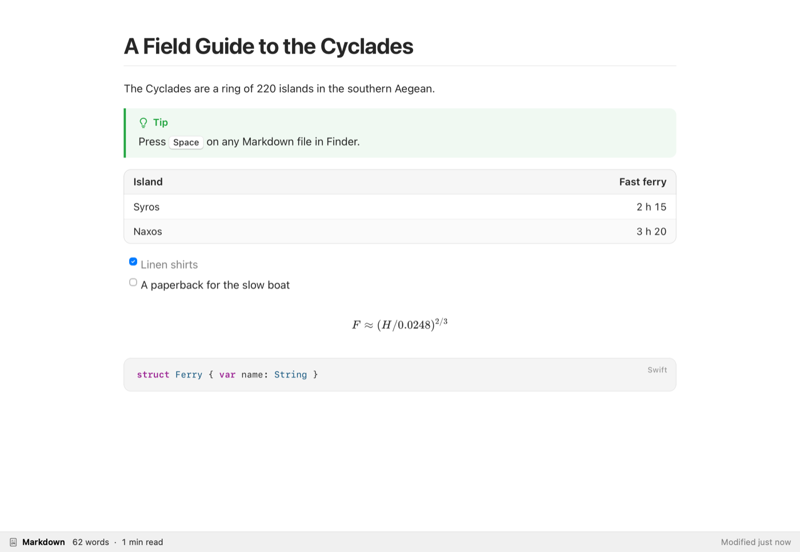
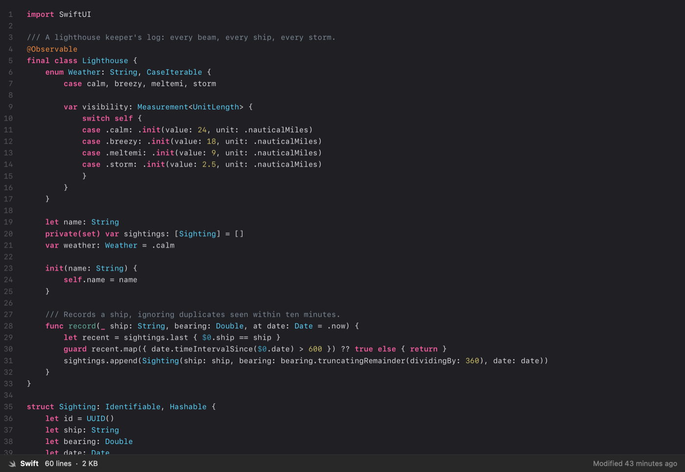
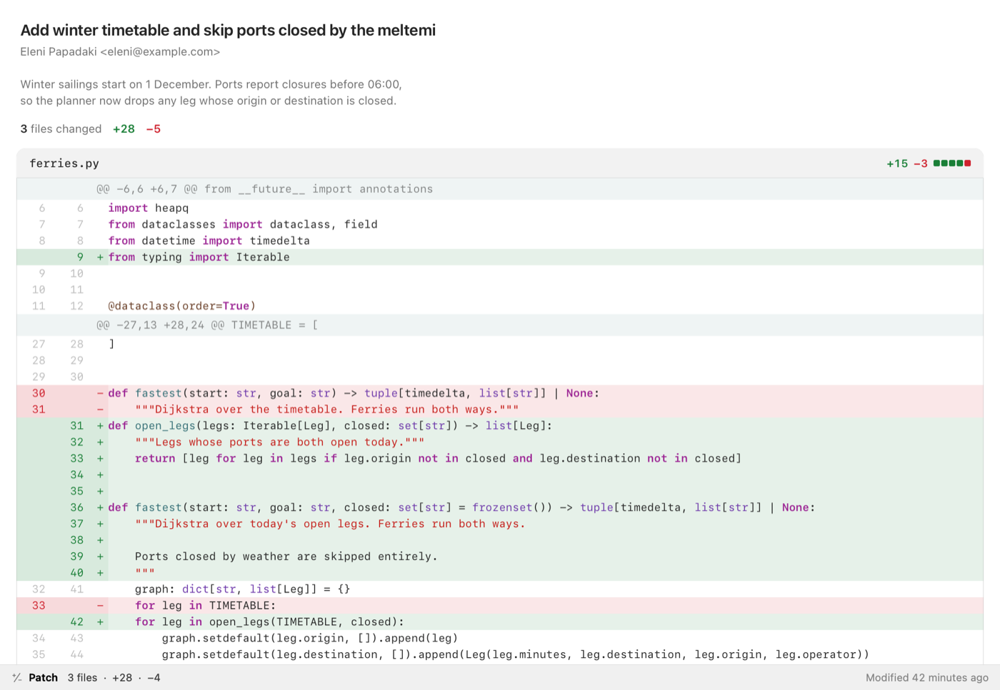
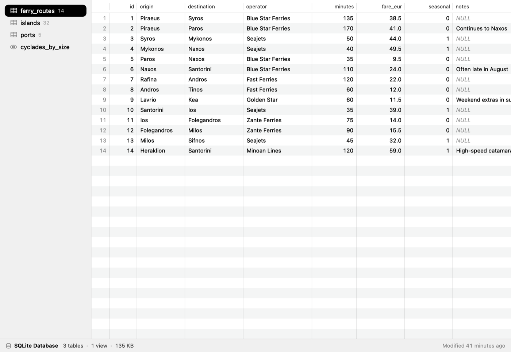
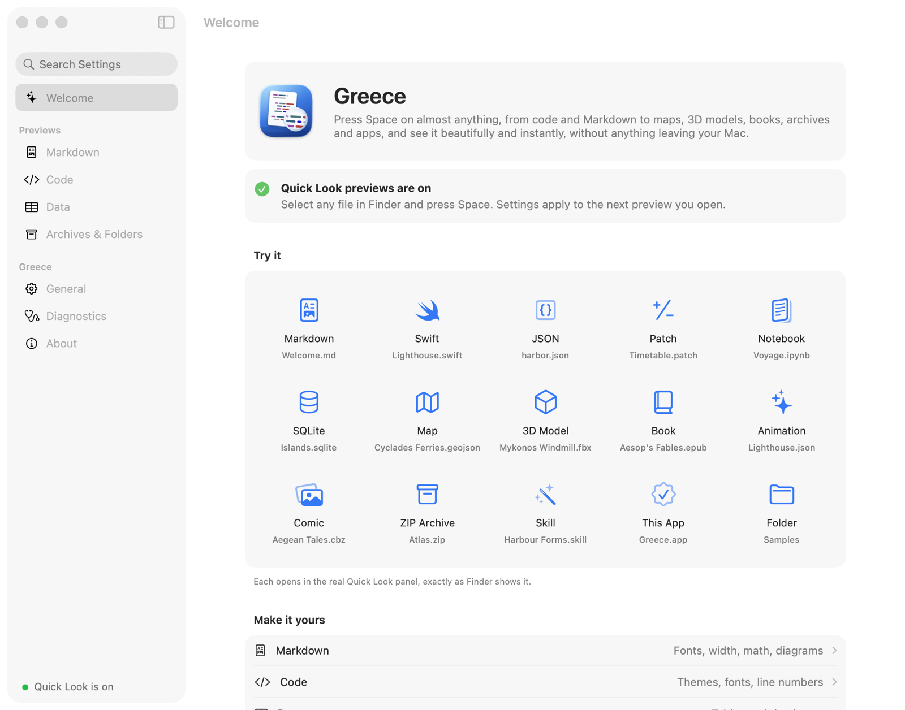
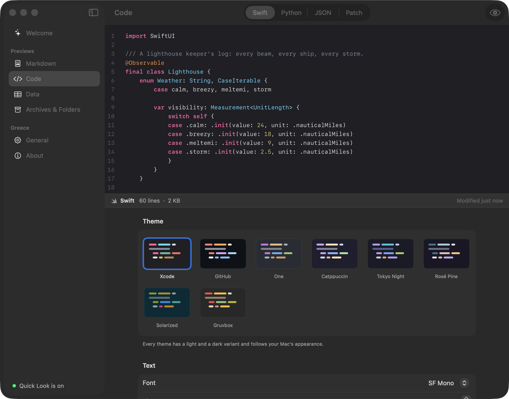

# Greece

**Press Space. See everything.**

Greece makes Quick Look beautiful for the files developers and writers live in. Select a file in Finder, press <kbd>Space</kbd>, and you get typeset Markdown, syntax-highlighted code, real tables, browsable archives and databases, readable diffs and rendered notebooks. Everything happens on your Mac, in a fraction of a second.

<p align="center">
  
  
</p>
<p align="center">
  
  
</p>

## What Greece previews

| | Formats | What you get |
|---|---|---|
| **Markdown** | `.md` `.markdown` `.mdx` `.rmd` `.qmd` TextBundle | GitHub Flavored Markdown, alerts, task lists, footnotes, emoji, KaTeX math, Mermaid diagrams, front matter as properties, an outline with scroll tracking, relative images |
| **Code** | 190+ languages | Xcode-quality highlighting, eight themes with light and dark variants, line numbers that stay aligned when wrapping, copy button, instant opening for 60,000-line files |
| **JSON & plists** | `.json` `.jsonc` `.geojson` `.plist` (XML and binary) | Minified JSON formatted with key order preserved, binary property lists decoded |
| **Notebooks** | `.ipynb` | Markdown cells, highlighted code, text, HTML tables, images, SVG and tracebacks |
| **Diffs** | `.diff` `.patch` | Per-file sections with status badges, +/− stats, old and new line numbers, syntax highlighting inside the diff, commit title and message for `git format-patch` files |
| **Tables** | `.tsv` `.tab` `.psv` | Native table with row numbers, numeric alignment, sorting, multi-row copy |
| **Databases** | `.sqlite` `.sqlite3` `.db` | Tables and views in a sidebar with row counts, column types on hover, lazy paging, sorting. Opened read-only and immutable |
| **Archives** | `.zip` `.jar` `.apk` `.tar` `.tgz` `.tar.gz` `.tbz2` `.txz` `.gz` `.bz2` `.xz` | Finder-style tree with sizes, dates and compression savings, without extracting anything. A compressed text file such as `server.log.gz` opens straight to its contents |
| **Folders** | Any folder | Finder-style list with icons, kinds, Finder tags and lazy expansion |

The info bar at the bottom of every preview shows what the file is at a glance: language and line count, words and reading time, rows and columns, or files and compression ratio.

### Finder thumbnails

Finder shows Greece thumbnails for source code, Markdown, logs, patches, property lists and tab- or pipe-separated tables: a miniature page of the file, highlighted in your code theme, or a table grid. They're drawn natively with highlight.js running in JavaScriptCore, so they need no web view.

Apple's own text thumbnailer also claims JSON and plain text, and macOS keeps `.txt`, CSV and extensionless files. After you install or update Greece, Finder can keep its old thumbnails until macOS restarts its thumbnail service, at the latest when you log out.

## The app

Open Greece once and it walks you through turning previews on. It checks that Quick Look is actually using this copy of Greece and fixes the common problems (a stale copy registered elsewhere, the extension switched off) with one button.

Every setting comes with a live preview rendered by the same engine Quick Look uses, so you see the effect before you press Space.

<p align="center">
  
  
</p>

## Privacy

- Previews are rendered on your Mac. No accounts, analytics or tracking.
- Markdown, code and math libraries are bundled with the app, so nothing is fetched from a CDN.
- Files are opened read-only. Databases are opened immutable, and archives are never extracted.
- The only network access is loading remote images referenced by Markdown, which you can turn off.
- Untrusted HTML in Markdown and notebooks is sanitized, and every preview page runs under a strict Content Security Policy with no script execution from documents.

## Building

Requirements: macOS 14 or later, Xcode 16 or later, [XcodeGen](https://github.com/yonaskolb/XcodeGen).

```sh
brew install xcodegen
xcodegen generate
open Greece.xcodeproj        # or build from the command line:
xcodebuild -project Greece.xcodeproj -scheme Greece -configuration Release -derivedDataPath build/dd build
```

Signing uses the Apple Development certificate for team `ZHCT595PYJ` (set in `project.yml`). The app is distributed directly, like Murmur, so it isn't sandboxed; the Quick Look extension is sandboxed, as macOS requires.

To install the build into `/Applications` and verify that Quick Look uses it, run `scripts/install.sh`. If Quick Look ever picks up another copy (a debug build, an older download), **Turn On Greece** on the app's Welcome page puts the installed copy back in charge.

### Tests

```sh
xcodebuild -project Greece.xcodeproj -scheme Greece -derivedDataPath build/dd test
```

The suite covers format detection, the language catalog (every grammar must ship in the bundle), the CSV engine, the JSON formatter, text decoding, settings migration and the archive readers, using real `zip`, `tar`, `gzip`, `bzip2` and `xz` output with Unicode and long file names.

### Rendering previews without Quick Look

The app doubles as a headless renderer, which is handy for design work and regression checks:

```sh
scripts/render.sh build/dd/Build/Products/Release/Greece.app /tmp/shots path/to/files…
scripts/render.sh build/dd/Build/Products/Release/Greece.app /tmp/shots --appearance dark --theme one file.swift
scripts/shoot-app.sh build/dd/Build/Products/Release/Greece.app code /tmp/code.png --appearance dark
scripts/shoot-quicklook.sh /Applications/Greece.app file.md /tmp/panel.png   # the real Quick Look panel, nothing else on screen
build/dd/Build/Products/Release/Greece.app/Contents/MacOS/Greece --thumbnail file.swift /tmp/thumb.png --size 512
swift scripts/ui-check.swift /Applications/Greece.app /tmp/ui   # clicks through the installed app and checks every step
```

`scripts/make-icon.swift` draws the app icon.

### Releasing

```sh
scripts/release.sh            # universal build, signed, packaged as build/release/Greece-<version>.dmg
```

The script signs with a Developer ID Application certificate when one is in the keychain and notarizes when `GREECE_NOTARY_PROFILE` names a `notarytool` profile. Without them it still produces a working, signed DMG, but Gatekeeper on other Macs will block it until it's notarized.

## How it works

```
Greece.app
├── Contents/Frameworks/GreeceKit.framework   shared engine: detection, parsers, renderers, web assets
├── Contents/PlugIns/GreeceQuickLook.appex     sandboxed Quick Look preview extension (a thin wrapper)
└── Contents/PlugIns/GreeceThumbnails.appex    sandboxed Finder thumbnail extension
```

- **GreeceKit** turns a file into a `PreviewView`. Detection looks at bytes first (SQLite, ZIP, gzip, bzip2, xz and tar signatures, binary versus text), then names and extensions, then shebangs and diff markers.
- **Web previews** (Markdown, code, diffs, notebooks) render in WKWebView through a private `greece://` URL scheme. `greece://asset/…` serves the bundled renderer and libraries; `greece://file/…` serves images and media next to the document and nothing else. Huge files paint their first screens immediately, stream the rest, and highlight in a Web Worker.
- **Native previews** (tables, databases, archives, folders, info bar) are AppKit table and outline views with system colors and fonts.
- **Archives** are read as streams: ZIP (including ZIP64) from its central directory, tar (ustar, GNU long names, PAX) through zlib, libbz2 or Apple's Compression for xz.
- **Settings** live in one JSON document in the App Group `ZHCT595PYJ.com.scorchy.greece`, which the app writes and the extension reads for every preview.

## What macOS keeps for itself

Quick Look picks a viewer for each file before it consults extensions, and for a few types it never hands the file over. Checked against Quick Look's own logs on macOS 26:

- **`.csv`**: Quick Look sees Greece's claim but sends CSV to Apple's Office previewer, one of two built-in generators it ranks ahead of extensions. A more specific CSV type doesn't help, because macOS keeps its own type for `.csv` whatever apps declare, and Quick Look has no setting for it. Tab- and pipe-separated files open in Greece.
- **`.ts` and `.mts`**: macOS types these as MPEG video, so Quick Look opens its movie viewer (which shows only an icon for TypeScript). `.tsx` and `.cts` open in Greece.
- **Plain text**: `.txt` files, and extensionless files macOS recognizes as text (`LICENSE`, `README`), stay with Apple's text viewer.

Other extensionless files do reach Greece: `Makefile` is recognized by name, and `Dockerfile`, `.gitignore`, `Procfile` and similar files open highlighted. Binary files Greece can't read fall back to Quick Look's standard file view.

## Acknowledgements

Greece bundles [markdown-it](https://github.com/markdown-it/markdown-it) with its footnote and emoji plugins, [highlight.js](https://highlightjs.org), [KaTeX](https://katex.org) and [Mermaid](https://mermaid.js.org). Their licenses ship with the app and appear on its About page.

© 2026 Scorchy
